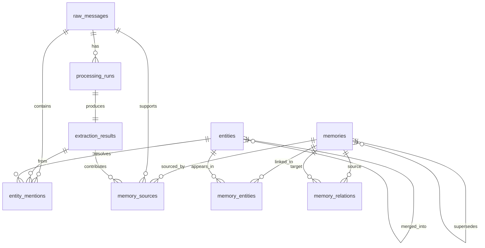

# Second Brain Backend

A personal memory layer: notes-to-self go in, and structured memories that point back to their evidence come out. Built with FastAPI, PostgreSQL, and Claude.

**Status on 18 October 2026:** Phase 0 (foundation) and Phase 1 (ingestion pipeline) are built and verified. A log of every model call and a web test console were added on top. The backend also serves the Muse mobile app (in the parent folder): signed-in users, chat with the assistant Cooper, scheduled tasks, and connected apps. Phase 2 (retrieval) is implemented as of 24 October 2026 (hybrid search over memories, ADR-038); its tests are written but not yet run; Neon is migrated to revision 009.

| Read this | For |
|---|---|
| [../docs/PROJECT_GUIDE.md](../docs/PROJECT_GUIDE.md) | The whole system: this backend and the Muse app, how to run both, code map, what is left |
| [RUN_LOCALLY.md](RUN_LOCALLY.md) | Setting up and starting everything on Windows without Docker |
| [PHASE1_REPORT.md](PHASE1_REPORT.md) | What Phase 1 built, every test and evaluation run, the costs, and what is still open |
| [context for agent/DECISIONS.md](context%20for%20agent/DECISIONS.md) | Why things are built the way they are (ADR-001 to ADR-037) |
| [context for agent/STATUS.md](context%20for%20agent/STATUS.md) | What is verified and what is not |
| [context for agent/ROADMAP.md](context%20for%20agent/ROADMAP.md) | The phases and their exit gates |

## What it does

1. **Capture.** A unit of one or more messages is stored as raw evidence that can never be changed.
2. **Extract.** A Claude model reads the unit and returns memories and entity mentions in a strict format. The answer is validated before anything is stored.
3. **Resolve.** Names are matched to known entities, exactly and conservatively. Unclear matches stay marked as ambiguous.
4. **Build.** Each memory is stored as `proposed`, linked to the messages and the quotes it rests on.
5. **Recover.** Failures are retried with backoff, and units can be replayed. Doing the same thing twice never creates duplicates.
6. **Observe.** Every model call is logged with its tokens, cost, and duration. A console shows usage and output quality.

## The assistant app

The Muse mobile app has no server of its own; this backend is it.

1. **Sign-in.** The app signs users in with Supabase Auth and sends the access token. The API verifies it against the Supabase project's published signing keys (ES256) and keeps a row per user in `app_users`.
2. **Chat.** `POST /threads/{id}/messages` stores the user's message and streams Cooper's reply as newline-delimited JSON. Cooper is Claude in a tool-use loop (`app/services/assistant/`); every model call is in the call log. The reply is stored when it ends, even if the app disconnects. A message can carry images or PDFs, which reach Claude with that message only. One reply runs per thread at a time, across processes, held by a lease on the thread.
3. **Tools.** Cooper can run a cloud browser task (Browserbase), use the user's connected apps (Composio), and propose a schedule. Actions that change data in an app need the user's confirmation in chat.
4. **Schedules.** Once on a date, daily, weekly on chosen days, monthly on a day, or every 1 to 24 hours, at a time in the user's timezone; editable and deletable. A proposed schedule becomes real only when the user confirms the card. The API dispatches due schedules itself (or `scripts/run_schedules.py` does); each slot is claimed in PostgreSQL and runs once. A scheduled run may change data only in the app it delivers to.
5. **Connected apps.** The catalog is code (`app/domain/tool_catalog.py`); Composio holds the credentials.
6. **Daily prompt limit.** Each user gets 40 prompts a day (chat messages and scheduled runs, per UTC day), counted in the `daily_usage` table by the same statement that checks the limit. Over it, sending answers 429 and a scheduled run fails without calling the model. `app_users.daily_prompt_limit` overrides the limit for one user. `GET /me/usage` is the app's meter. There is no billing.
7. **Account.** The user personalizes the assistant (`PATCH /me`), sends feedback, and can delete the account: connected apps are revoked, all data is deleted, and the Supabase sign-in is deleted when `SUPABASE_SECRET_KEY` is set.
8. **Push.** When a scheduled run ends, the owner's registered devices get an Expo push notification that opens the result.
9. **Memories from chats.** Each message a user sends goes through the memory pipeline in the background and becomes memories owned by that user (`GET /me/memories`). Evidence, entities, and memories carry an owner; entity resolution never crosses owners, and the unauthenticated console shows only the operator's own data. Users can turn capture off.
10. **Memory search.** `POST /me/memories/search` finds the user's memories by their words, the people and places they name (typos tolerated), and their meaning (pgvector embeddings from Voyage AI, when `VOYAGE_API_KEY` is set), fused by rank, each with the messages it rests on. Cooper searches the same way with its `search_memories` tool. Without a key, or if Voyage fails, search still runs on words and names and says so (`degraded`). An indexer loop embeds new memories in the background; `scripts/index_memories.py` and `scripts/run_retrieval_eval.py` index and measure by hand.
11. **Managing memories.** Users review, accept, correct (a new version that keeps the old one's evidence), retract, restore, merge, replace, and delete their memories; each change is recorded in the memory's history. A review inbox suggests duplicates and conflicts (no model involved) and shows messages the pipeline held back. People can be renamed and merged. Sensitive memories never reach a model. `GET /me/export` returns all of a user's data. Failed saves are retried by the API. See ADR-044.
12. **Life state and reminders.** `GET /me/life` lists open tasks, plans, and goals by when they are due; items are done, dropped, reopened, rescheduled, or reminded of. The API posts due reminders and an optional daily brief (no model) to chat and pushes them. Cooper can set reminders and check items off. `POST /me/messages/search` searches the user's chats. See ADR-045.
13. **Insights.** `GET /me/insights` turns the user's memories into grounded insights without a model: money noted this month, people on their mind or gone quiet, how much of what they plan gets done, quiet goals, recurring themes. Each names its evidence; feedback hides the unhelpful ones and measures usefulness per kind. See ADR-046.
14. **New memory sources.** A WhatsApp export is previewed (participants, conversations, cost) and then imported as conversations, in the background. A photo or PDF is read by Claude into evidence. Google Calendar events become plans when the user turns the calendar on as a source. See ADR-047.

The database is the hosted PostgreSQL on Neon; Supabase only signs users in. Every table also has row level security without policies, so no role but the tables' owner, which the API connects as, can use the data; that keeps it closed even if the database moves to a host that publishes it through a Data API, as Supabase does. Decisions are in ADR-026 to ADR-038.

## Architecture Overview

The backend uses a layered architecture to keep concerns apart:
- **API (app/api/)**: FastAPI routes, endpoints, and dependency injection.
- **Service (app/services/)**: Business logic and workflow orchestration. The pipeline is in `app/services/processing/`.
- **Repository (app/repositories/)**: Data access, hiding the SQLAlchemy operations.
- **Database (app/db/ and app/models/)**: ORM models and session management. Migrations are in `migrations/`.
- **Domain (app/domain/ and app/schemas/)**: Rules, vocabularies, the model price catalog, and the Pydantic contracts.
- **Core (app/core/)**: Configuration, logging, request logging, and error mapping.
- **Integrations (app/integrations/)**: The Anthropic client, the extractor, and the observer that logs each model call.
- **Evaluation (evaluation/)**: Golden dataset loader, scoring, judge, and reports.
- **Console (frontend/)**: The React test console, built into `frontend/dist` and served by the API at `/`.

**Lifespan management:** FastAPI's lifespan events manage the singletons. There is one `AsyncEngine`, one `async_sessionmaker`, and one `AsyncAnthropic` client per process. Each HTTP request gets its own `AsyncSession`, which a FastAPI dependency commits or rolls back.

## Database Schema



| Table | Purpose |
|---|---|
| `raw_messages` | Source evidence. A trigger rejects every update |
| `processing_runs` | One run per unit and pipeline version: queued, running, succeeded, needs_review, or failed |
| `processing_run_messages` | The ordered messages of a unit |
| `processing_run_events` | Append-only history of every attempt |
| `extraction_results` | The validated output of the model, one per run |
| `entity_mentions` | Names found in the messages, with how they were resolved |
| `entities` | Canonical people, projects, and topics. Merges point at the surviving entity |
| `memories` | The memory statements. The pipeline only writes `proposed` ones |
| `memory_sources` | Which messages and quotes a memory rests on |
| `memory_entities` | Which entities appear in which memories |
| `memory_relations` | Explicit relationships between memories, e.g. which memory replaced which |
| `memory_events` | The change history of each memory: what its owner did and when |
| `llm_calls` | One row per model call: tokens, cost, duration, result. Never the content |
| `playground_runs` | Test calls made from the console |
| `evaluation_runs`, `evaluation_case_results` | Stored evaluations and the result of each case |
| `app_users` | People signed in through Supabase Auth, keyed by their Supabase id |
| `chat_threads`, `chat_messages` | Conversations with the assistant. One main thread per user, any number of side threads |
| `scheduled_tasks`, `scheduled_task_runs` | Confirmed schedules, and one row per run. One run per slot, one running run per schedule |
| `tool_connections` | Each user's last known connection to each app of the catalog |

The schema is created only by the five Alembic migrations in `migrations/versions/`. A test compares the models with the migrated schema and fails on any difference.

## Quick Start

**Windows without Docker:** follow [RUN_LOCALLY.md](RUN_LOCALLY.md).

**With Docker for PostgreSQL:** you need Python 3.12+, Docker with Docker Compose, and `uv`.

```bash
make install            # 1. install dependencies
make docker-up          # 2. start PostgreSQL
cp .env.example .env    # 3. then edit .env, see below
make migrate            # 4. apply migrations
make dev                # 5. start the API
```

Then open <http://localhost:8000> for the console and <http://localhost:8000/docs> for the API documentation. The console needs `frontend/dist`, which is not in version control. See "Change the console" in [RUN_LOCALLY.md](RUN_LOCALLY.md).

## Environment Configuration

All settings are in `.env`. The file `.env.example` lists every one with its default.

| Variable | Default | Description |
|---|---|---|
| `DATABASE_URL` | local PostgreSQL | Async PostgreSQL connection string. A hosted database needs `postgresql+asyncpg://...?ssl=require` |
| `ANTHROPIC_API_KEY` | none | Needed for everything that calls a model. The API starts without it, and captured notes wait in the queue |
| `ANTHROPIC_MODEL` | `claude-sonnet-5-5` | Model used for extraction. `claude-haiku-5-5` costs about a tenth |
| `ANTHROPIC_TIMEOUT`, `ANTHROPIC_MAX_RETRIES` | 60, 2 | Request timeout in seconds and SDK retries |
| `ANTHROPIC_REFUSAL_FALLBACK` | true | Retry a declined note on the fallback model. Only requested from models that have one |
| `EXTRACTION_EFFORT`, `EXTRACTION_MAX_TOKENS` | medium, 16000 | How hard the model thinks and how much it may write |
| `DEFAULT_TIMEZONE` | UTC | The timezone notes are written in. Decides which day "tomorrow" means |
| `PIPELINE_MAX_ATTEMPTS`, `PIPELINE_RETRY_*`, `PIPELINE_RUN_LEASE_SECONDS` | 3, 30 to 900 s, 600 s | Retries, backoff, and when an abandoned run is released |
| `PIPELINE_WORKER_ENABLED`, `PIPELINE_WORKER_INTERVAL_SECONDS`, `PIPELINE_WORKER_BATCH_SIZE` | on, 30 s, 10 | The API retries due runs itself |
| `INGESTION_MAX_*` | 20, 100, 20000 | Messages per unit, units per batch, characters per message |
| `EVALUATION_DATASET_PATH` | `golden.jsonl` | The golden dataset |
| `EVALUATION_STALE_AFTER_SECONDS` | 900 | When a silent evaluation run is marked as interrupted |
| `CONSOLE_UI_DIR` | `frontend/dist` | The built console, served at `/` when the folder exists |
| `SUPABASE_URL`, `SUPABASE_JWKS_URL` | none | The Supabase project whose access tokens the API accepts. Without it, every app route answers 503 |
| `ASSISTANT_MODEL`, `ASSISTANT_EFFORT`, `ASSISTANT_MAX_TOKENS`, `ASSISTANT_MAX_STEPS`, `ASSISTANT_HISTORY_MESSAGES` | `ANTHROPIC_MODEL`, medium, 8000, 10, 40 | Cooper's model and limits |
| `SCHEDULER_ENABLED`, `SCHEDULER_POLL_SECONDS`, `SCHEDULER_BATCH_SIZE`, `SCHEDULER_CONCURRENCY`, `SCHEDULE_RUN_STALE_SECONDS` | true, 60, 10, 3, 1800 | The in-process schedule dispatcher |
| `COMPOSIO_API_KEY`, `COMPOSIO_AUTH_CONFIGS` | none | Connected apps. Without a key the catalog lists but nothing connects |
| `BROWSERBASE_API_KEY`, `BROWSERBASE_RUN_TIMEOUT_SECONDS` | none, 240 | Cooper's cloud browser. Without a key there is no browser tool |
| `LOG_LEVEL`, `ENVIRONMENT`, `APP_NAME`, `API_V1_PREFIX`, `CORS_ORIGINS`, `DB_POOL_*`, `INTEGRATION_TIMEOUT_SECONDS` | see `.env.example` | General settings |

Never commit `.env`. It is listed in `.gitignore`, together with `golden.jsonl` and `eval_reports/`, which contain private notes.

## Development Commands

| Command | Description |
|---|---|
| `make install` | Install all dependencies with uv |
| `make dev` | Start the API with auto-reload |
| `make dev-lan` | The same, reachable from a phone on the network, for the mobile app |
| `make schedules` | Run due schedules in a separate process. The API does this itself while `SCHEDULER_ENABLED` is true |
| `make worker` | Process queued runs: retries that are due, and notes captured without a key |
| `make migrate`, `make migrate-down` | Upgrade to the latest migration, or go back one |
| `make migration msg="x"` | Generate a new migration |
| `make test` | Run all tests. Needs the local PostgreSQL |
| `make test-unit`, `make test-contract`, `make test-golden`, `make test-integration` | Run one suite |
| `make coverage` | Run all tests and report coverage |
| `make lint`, `make format`, `make typecheck` | Ruff linter, Ruff formatter, mypy |
| `make connection-check` | One tiny model call, to check the key and the model |
| `make eval` | Live evaluation on the golden dataset. Calls the model and costs money |
| `make import-eval-reports` | Store earlier evaluation report files in the database |
| `make ui-install`, `make ui-dev`, `make ui-build`, `make ui-check` | Work on the console. Needs Node 20.19 or newer |
| `make docker-up`, `make docker-down`, `make docker-build` | PostgreSQL in Docker, and the API image |

`make` is usually not installed on Windows. [RUN_LOCALLY.md](RUN_LOCALLY.md) lists the PowerShell equivalent of each target.

## Testing

| Suite | Tests | Needs a database | Covers |
|---|---|---|---|
| `tests/unit` | 500 | No | Domain rules, the Anthropic adapters, the call observer, prices, scoring, schedule rules, token verification, the assistant loop and tools, the Composio and Browserbase clients |
| `tests/contract` | 37 | No | The published API and the extraction output format |
| `tests/golden` | 140 | No | The golden dataset and its label mapping |
| `tests/integration` | 413 | Yes | Migrations, constraints, row level security, the pipeline, replay, the call log, evaluations, the console API, chat, schedules and the dispatcher, app connections |

1090 tests, 98 percent coverage. No test calls a model or any other external service: the assistant app's tests use a scripted model, a token verifier, and in-memory Composio and Browserbase.

Integration tests use the database `second_brain_test` on the local PostgreSQL. The test setup forces that address before any application code loads, so tests cannot reach the application database. They build the test database with the real migrations and empty it afterwards. Never point `TEST_DATABASE_URL` at a database that holds data you want to keep.

## API

Interactive documentation is at <http://localhost:8000/docs> when the server runs. All paths start with `/api/v1`.

| Area | Operations |
|---|---|
| Health | `GET /health/live`, `GET /health/ready` |
| Capture | `POST /ingestion/units`, `POST /ingestion/batches` |
| Processing | `GET /processing/runs`, `GET /processing/runs/{run_id}`, `POST /processing/replays` |
| Memories | `GET /memories`, `POST /memories/search`, `GET /memories/{memory_id}` |
| Model calls | `GET /llm-calls`, `GET /llm-calls/usage`, `GET /llm-calls/{call_id}` |
| Test calls | `POST /playground/extractions`, `GET /playground/extractions`, `GET /playground/extractions/{run_id}`, `GET /playground/contract` |
| Evaluations | `GET /evaluations`, `POST /evaluations`, `GET /evaluations/dataset`, `GET /evaluations/failing-cases`, `GET /evaluations/{run_id}`, `GET /evaluations/{run_id}/cases`, `GET /evaluations/{run_id}/cases/{case_id}`, `POST /evaluations/{run_id}/cancel` |
| Console | `GET /console/config`, `POST /console/connection-check`, `GET /console/pipeline-stats`, `GET /reports/{slug}` |
| User | `GET /me`, `PATCH /me`, `DELETE /me`, `GET /me/export`, `GET /me/usage`, `GET /me/usage/history`, `POST /me/push-tokens`, `DELETE /me/push-tokens/{token}`, `POST /feedback` |
| My memories | `GET /me/memories`, `POST /me/memories`, `POST /me/memories/search`, `GET /me/memories/review`, `POST /me/memories/review/accept`, `POST /me/memories/review/dismiss`, `POST /me/memories/held-back/{run_id}/save`, `POST /me/memories/held-back/{run_id}/dismiss`, `GET/PATCH/DELETE /me/memories/{memory_id}`, `POST /me/memories/{memory_id}/accept`, `/retract`, `/restore`, `/merge`, `/replace` |
| People | `GET /me/people`, `GET/PATCH /me/people/{person_id}`, `POST /me/people/{person_id}/merge` |
| Sources | `POST /me/imports/whatsapp`, `POST /me/imports/{import_id}/start`, `GET /me/imports`, `GET /me/imports/{import_id}`, `POST /me/memories/from-file`, `GET /me/sources`, `PATCH /me/sources/{app}`, `POST /me/sources/{app}/sync` |
| Insights | `GET /me/insights`, `POST /me/insights/feedback`; operator: `GET /console/insights/usefulness` |
| Life | `GET /me/life`, `GET /me/life/brief`, `POST /me/memories/{memory_id}/complete`, `/drop`, `/reopen`, `POST /me/messages/search` |
| Chat | `GET /threads`, `POST /threads`, `POST /threads/main`, `GET /threads/{thread_id}`, `DELETE /threads/{thread_id}`, `DELETE /threads/{thread_id}/messages`, `GET /threads/{thread_id}/messages`, `POST /threads/{thread_id}/messages` (NDJSON reply stream), `POST /threads/{thread_id}/messages/{message_id}/proposal/confirm`, `POST /threads/{thread_id}/messages/{message_id}/proposal/dismiss` |
| Schedules | `GET /schedules`, `POST /schedules`, `GET /schedules/{schedule_id}`, `PATCH /schedules/{schedule_id}`, `DELETE /schedules/{schedule_id}`, `POST /schedules/{schedule_id}/runs`, `GET /schedules/{schedule_id}/runs`, `GET /schedules/{schedule_id}/runs/{run_id}` |
| Apps | `GET /tools`, `POST /tools/{slug}/connect`, `GET /tools/{slug}/connection`, `DELETE /tools/{slug}/connection` |
| Activity | `GET /activity` |

The User, Chat, Schedules, Apps, and Activity routes need a Supabase access token (`Authorization: Bearer ...`) and only ever show the signed-in user's own records. The memory-layer and console routes have no sign-in; they answer only the computer running the API, or a request carrying `OPERATOR_API_KEY` in `X-Operator-Key` (ADR-040). So `make dev-lan` exposes the app's routes to the phone, not the console: open the console at `http://localhost:8000`.

## Test console

The console is served at <http://localhost:8000>. It has screens for an overview of cost and quality, a single test call, evaluations, the log of model calls, the pipeline, and the Phase 1 results. [RUN_LOCALLY.md](RUN_LOCALLY.md) describes each screen.

## Evaluation

Quality is checked in three layers: deterministic tests, all golden cases through the real pipeline with a stand-in extractor, and a live evaluation with a real model. A live evaluation sends the notes of `golden.jsonl` to Anthropic and costs money: about 0.10 US dollars per run on Haiku and about 1.03 on Sonnet. Start one from the console or with `make eval`. Results are stored in the database.

The best results so far are 122 of 124 cases with Sonnet 5.5 and 120 with Haiku 5.5. [PHASE1_REPORT.md](PHASE1_REPORT.md) has every run.

## Design Notes

- **UUIDv7 primary keys**: time-ordered, which keeps indexes compact.
- **Numeric(3,2) confidence**: fixed precision, no floating-point surprises.
- **RESTRICT on foreign keys**: evidence is never deleted by a cascade.
- **Vocabularies as CHECK constraints**: generated from the domain enums, so the database refuses unknown values.
- **No clients at module level**: all singletons are managed through the FastAPI lifespan.
- **The pipeline only proposes**: it never activates, merges, or overwrites a memory.
- **The call log holds facts, never content**: no prompt, no note, no answer.

Status transitions:
- **ProcessingRun**: queued, then running, then succeeded, needs_review, or failed. A run returns to queued for a retry.
- **Memory**: proposed, then active, then superseded or retracted. Only `proposed` is written today.
- **Entity**: active, then merged or archived.
- **EntityMention**: unresolved, then resolved, ambiguous, or rejected.

## What is next

Phase 2: run the retrieval tests (they need pgvector locally, see RUN_LOCALLY.md) and measure retrieval with the real embedding model. Then Phase 3, memory management. See [context for agent/ROADMAP.md](context%20for%20agent/ROADMAP.md). For the assistant app, the open items are listed under "Not verified, or open" in [context for agent/STATUS.md](context%20for%20agent/STATUS.md), first among them sign-in for the memory-layer routes. The open items of Phase 1 are listed in section 12 of [PHASE1_REPORT.md](PHASE1_REPORT.md).
